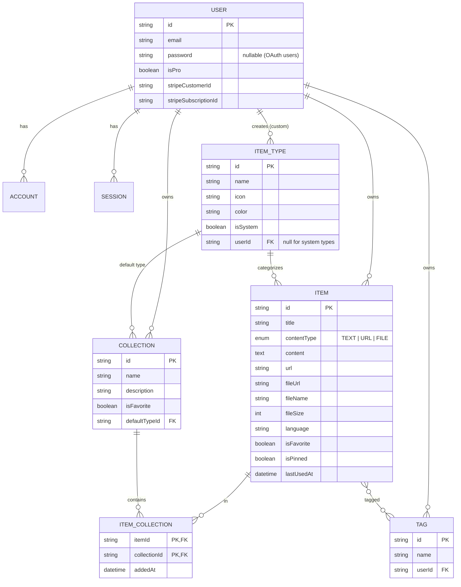
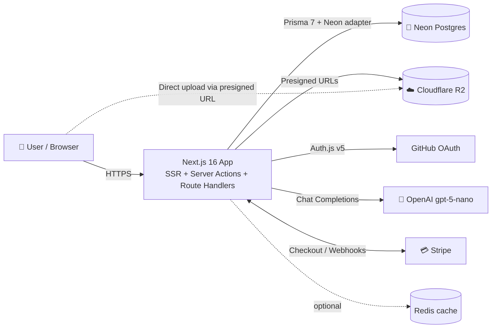
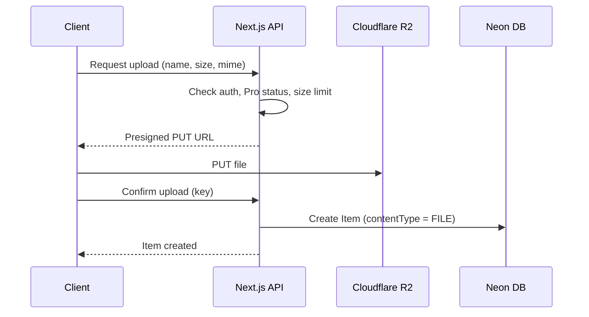

# 🗂️ DevStash — Project Overview

> **One fast, searchable, AI-enhanced hub for all your dev knowledge & resources.**

---

## 📌 Table of Contents

1. [Problem](#-problem)
2. [Target Users](#-target-users)
3. [Features](#-features)
4. [Data Model](#-data-model)
5. [Tech Stack](#-tech-stack)
6. [Architecture](#-architecture)
7. [Monetization](#-monetization)
8. [UI / UX](#-ui--ux)
9. [Routes](#-routes)
10. [Development Rules](#-development-rules)
11. [Open Questions](#-open-questions)

---

## 🧩 Problem

Developers keep their essentials scattered:

| Resource            | Where it usually lives        |
| ------------------- | ----------------------------- |
| Code snippets       | VS Code, Notion               |
| AI prompts          | Buried in chat histories      |
| Context files       | Hidden inside projects        |
| Useful links        | Browser bookmarks             |
| Docs                | Random folders                |
| Commands            | `.txt` files                  |
| Project templates   | GitHub Gists                  |
| Terminal commands   | Bash history                  |

This causes **context switching, lost knowledge, and inconsistent workflows**.

**DevStash** gives developers a single place to save, organize, search, and reuse all of it, with AI to help tag, summarize, and explain.

---

## 👥 Target Users

| Persona                         | Primary Need                                              |
| ------------------------------- | --------------------------------------------------------- |
| 🧑‍💻 **Everyday Developer**        | Quickly grab snippets, prompts, commands, links           |
| 🤖 **AI-first Developer**         | Save prompts, contexts, workflows, system messages        |
| 🎓 **Content Creator / Educator** | Store code blocks, explanations, course notes             |
| 🏗️ **Full-stack Builder**         | Collect patterns, boilerplates, API examples              |

---

## ✨ Features

### A. Items & Item Types

Every item has a **type**. DevStash ships with fixed **system types** (they can't be edited or deleted). **Custom types** are a later Pro feature.

| Type      | Content Kind | Icon                | Color                                    | Plan |
| --------- | ------------ | ------------------- | ---------------------------------------- | ---- |
| Snippet   | `TEXT`       | `Code`              |  `#3b82f6` blue    | Free |
| Prompt    | `TEXT`       | `Sparkles`          |  `#8b5cf6` purple  | Free |
| Note      | `TEXT`       | `StickyNote`        |  `#fde047` yellow  | Free |
| Command   | `TEXT`       | `Terminal`          |  `#f97316` orange  | Free |
| Link      | `URL`        | `Link`              |  `#10b981` emerald | Free |
| File      | `FILE`       | `File`              |  `#6b7280` gray    | Pro  |
| Image     | `FILE`       | `Image`             |  `#ec4899` pink    | Pro  |

Icons are from [Lucide](https://lucide.dev/icons/) (bundled with shadcn/ui via `lucide-react`).

- Type list pages use plural slugs: `/items/snippets`, `/items/prompts`, `/items/links`, etc.
- Items are created and viewed in a **quick-access drawer**, not a separate page.

### B. Collections

- A collection can hold items of **any type**.
- An item can belong to **multiple collections** (many-to-many), e.g. a React snippet in both *React Patterns* and *Interview Prep*.
- Examples:
  - **React Patterns**: snippets, notes
  - **Context Files**: files
  - **Python Snippets**: snippets

### C. Search

Search across:

- Title
- Content
- Tags
- Type

> Start with Postgres full-text search (`tsvector` + GIN index). Move to something heavier only if needed.

### D. Authentication

- Email / password
- GitHub OAuth

### E. Core Features

- ⭐ Favorite items and collections
- 📌 Pin items to the top
- 🕒 Recently used items
- 📥 Import code from a file
- 📝 Markdown editor for text types
- 📤 File upload for file types (file / image)
- 💾 Export data (JSON / ZIP)
- 🌙 Dark mode by default
- ➕ Add / remove an item to / from multiple collections
- 🔗 See which collections an item belongs to

### F. AI Features (Pro)

| Feature                 | Description                                         |
| ----------------------- | --------------------------------------------------- |
| 🏷️ Auto-tag suggestions | Suggest tags based on content                       |
| 📄 Summaries            | Short summary of long notes, files, or snippets     |
| 💡 Explain This Code    | Plain-English explanation of a snippet              |
| ⚡ Prompt Optimizer     | Rewrites a prompt to be clearer and more effective  |

---

## 🗄️ Data Model

> ⚠️ Draft schema. Not set in stone.

### Entity Relationship Diagram



### Prisma Schema (draft)

```prisma
// prisma/schema.prisma
// Prisma 7: connection URL lives in prisma.config.ts, and the Neon driver adapter
// is passed to PrismaClient at runtime. Check the latest docs before setup.

generator client {
  provider = "prisma-client"
  output   = "../src/generated/prisma"
}

datasource db {
  provider = "postgresql"
}

// ─────────────────────────────────────────────
// Auth (NextAuth / Auth.js v5 + Prisma adapter)
// ─────────────────────────────────────────────

model User {
  id            String    @id @default(cuid())
  name          String?
  email         String    @unique
  emailVerified DateTime?
  image         String?
  password      String?   // hashed; null for OAuth-only users

  // Billing
  isPro                Boolean @default(false)
  stripeCustomerId     String? @unique
  stripeSubscriptionId String? @unique

  accounts    Account[]
  sessions    Session[]
  items       Item[]
  itemTypes   ItemType[]
  collections Collection[]
  tags        Tag[]

  createdAt DateTime @default(now())
  updatedAt DateTime @updatedAt
}

model Account {
  id                String  @id @default(cuid())
  userId            String
  type              String
  provider          String
  providerAccountId String
  refresh_token     String? @db.Text
  access_token      String? @db.Text
  expires_at        Int?
  token_type        String?
  scope             String?
  id_token          String? @db.Text
  session_state     String?

  user User @relation(fields: [userId], references: [id], onDelete: Cascade)

  @@unique([provider, providerAccountId])
}

model Session {
  id           String   @id @default(cuid())
  sessionToken String   @unique
  userId       String
  expires      DateTime

  user User @relation(fields: [userId], references: [id], onDelete: Cascade)
}

model VerificationToken {
  identifier String
  token      String   @unique
  expires    DateTime

  @@unique([identifier, token])
}

// ─────────────────────────────────────────────
// App models
// ─────────────────────────────────────────────

enum ContentType {
  TEXT
  URL
  FILE
}

model Item {
  id          String      @id @default(cuid())
  title       String
  description String?
  contentType ContentType

  content  String? @db.Text // TEXT types
  url      String?          // URL types (link)
  fileUrl  String?          // FILE types: R2 object URL/key
  fileName String?          // original filename
  fileSize Int?             // bytes
  language String?          // optional, for syntax highlighting

  isFavorite Boolean   @default(false)
  isPinned   Boolean   @default(false)
  lastUsedAt DateTime? // powers "Recently used"

  userId String
  user   User   @relation(fields: [userId], references: [id], onDelete: Cascade)

  itemTypeId String
  itemType   ItemType @relation(fields: [itemTypeId], references: [id])

  tags        Tag[]            // implicit many-to-many
  collections ItemCollection[]

  createdAt DateTime @default(now())
  updatedAt DateTime @updatedAt

  @@index([userId])
  @@index([userId, itemTypeId])
  @@index([userId, isPinned])
  @@index([userId, lastUsedAt])
}

model ItemType {
  id       String  @id @default(cuid())
  name     String  // "snippet", "prompt", ...
  icon     String  // Lucide icon name, e.g. "Code"
  color    String  // hex, e.g. "#3b82f6"
  isSystem Boolean @default(false)

  userId String? // null for system types
  user   User?   @relation(fields: [userId], references: [id], onDelete: Cascade)

  items              Item[]
  defaultCollections Collection[]

  @@unique([userId, name])
}

model Collection {
  id          String  @id @default(cuid())
  name        String
  description String?
  isFavorite  Boolean @default(false)

  defaultTypeId String? // used for empty collections (card color, new-item default)
  defaultType   ItemType? @relation(fields: [defaultTypeId], references: [id])

  userId String
  user   User   @relation(fields: [userId], references: [id], onDelete: Cascade)

  items ItemCollection[]

  createdAt DateTime @default(now())
  updatedAt DateTime @updatedAt

  @@index([userId])
}

model ItemCollection {
  itemId       String
  collectionId String
  addedAt      DateTime @default(now())

  item       Item       @relation(fields: [itemId], references: [id], onDelete: Cascade)
  collection Collection @relation(fields: [collectionId], references: [id], onDelete: Cascade)

  @@id([itemId, collectionId])
  @@index([collectionId])
}

model Tag {
  id     String @id @default(cuid())
  name   String
  userId String
  user   User   @relation(fields: [userId], references: [id], onDelete: Cascade)

  items Item[]

  @@unique([userId, name])
}
```

### Seed data: system item types

```ts
// prisma/seed.ts
export const SYSTEM_ITEM_TYPES = [
  { name: "snippet", icon: "Code",       color: "#3b82f6" },
  { name: "prompt",  icon: "Sparkles",   color: "#8b5cf6" },
  { name: "note",    icon: "StickyNote", color: "#fde047" },
  { name: "command", icon: "Terminal",   color: "#f97316" },
  { name: "link",    icon: "Link",       color: "#10b981" },
  { name: "file",    icon: "File",       color: "#6b7280" }, // Pro
  { name: "image",   icon: "Image",      color: "#ec4899" }, // Pro
] as const;
```

> **Note:** Postgres treats `NULL`s as distinct in unique constraints, so `@@unique([userId, name])` won't stop duplicate system types. Seed them with `upsert` keyed on a fixed `id`.

---

## 🛠️ Tech Stack

| Layer            | Choice                                                        | Docs |
| ---------------- | ------------------------------------------------------------- | ---- |
| Framework        | **Next.js 16** (App Router) + **React 19**                    | [nextjs.org/docs](https://nextjs.org/docs) |
| Language         | **TypeScript**                                                | [typescriptlang.org](https://www.typescriptlang.org/docs/) |
| Database         | **Neon** (serverless PostgreSQL)                              | [neon.com/docs](https://neon.com/docs) |
| ORM              | **Prisma 7**                                                  | [prisma.io/docs](https://www.prisma.io/docs) |
| Auth             | **Auth.js / NextAuth v5** (Credentials + GitHub)              | [authjs.dev](https://authjs.dev) |
| File Storage     | **Cloudflare R2** (S3-compatible)                             | [developers.cloudflare.com/r2](https://developers.cloudflare.com/r2/) |
| AI               | **OpenAI** `gpt-5-nano`                                       | [platform.openai.com/docs](https://platform.openai.com/docs) |
| Styling          | **Tailwind CSS v4**                                           | [tailwindcss.com/docs](https://tailwindcss.com/docs) |
| UI Components    | **shadcn/ui** + **Lucide** icons                              | [ui.shadcn.com](https://ui.shadcn.com) · [lucide.dev](https://lucide.dev) |
| Payments         | **Stripe** (Checkout + Customer Portal + webhooks)            | [docs.stripe.com](https://docs.stripe.com) |
| Caching          | **Redis** *(optional, later)*, e.g. Upstash                   | [upstash.com/docs](https://upstash.com/docs/redis) |

**Approach**

- Single Next.js codebase/repo to keep overhead low
- Server-rendered pages with client components where interactivity is needed
- Route Handlers / Server Actions for backend work: CRUD, file uploads, AI calls, Stripe webhooks

---

## 🏛️ Architecture



### File upload flow



---

## 💰 Monetization

Freemium model.

| Feature                          | Free             | Pro                 |
| -------------------------------- | :--------------: | :-----------------: |
| Items                            | 50 total         | Unlimited           |
| Collections                      | 3                | Unlimited           |
| System types                     | All except File/Image | All            |
| File & image uploads             | ❌               | ✅                  |
| Search                           | Basic            | Basic               |
| Custom types                     | ❌               | ✅ *(later)*        |
| AI auto-tagging                  | ❌               | ✅                  |
| AI summaries                     | ❌               | ✅                  |
| AI code explanation              | ❌               | ✅                  |
| AI prompt optimizer              | ❌               | ✅                  |
| Export (JSON / ZIP)              | ❌               | ✅                  |
| Priority support                 | ❌               | ✅                  |
| **Price**                        | **$0**           | **$8/mo** or **$72/yr** (25% off) |

> 🚧 **During development:** build the Pro plumbing (`isPro`, Stripe IDs, limit checks), but **let all users access everything**. Gate checks behind one helper, e.g. `canUseProFeature(user)`, so turning enforcement on later is a one-line change.

---

## 🎨 UI / UX

### Principles

- Modern, minimal, developer-focused
- **Dark mode by default**, light mode optional
- Clean typography, generous whitespace
- Subtle borders and shadows
- Syntax highlighting for code blocks (e.g. [Shiki](https://shiki.style))
- Inspiration: [Notion](https://notion.so), [Linear](https://linear.app), [Raycast](https://raycast.com)

### Layout

```
┌──────────────────────────────────────────────────────────────┐
│  🔍 Search…                                     [+ New] [👤] │
├───────────────┬──────────────────────────────────────────────┤
│ SIDEBAR       │  MAIN                                        │
│               │                                              │
│ Types         │  Collections                                 │
│  </> Snippets │  ┌──────────┐ ┌──────────┐ ┌──────────┐      │
│  ✨ Prompts   │  │ React    │ │ Context  │ │ Python   │      │
│  >_ Commands  │  │ Patterns │ │ Files    │ │ Snippets │      │
│  📝 Notes     │  └──────────┘ └──────────┘ └──────────┘      │
│  🔗 Links     │   (background = dominant item type color)    │
│  📄 Files     │                                              │
│  🖼  Images    │  Items                                       │
│               │  ┌────────┐ ┌────────┐ ┌────────┐            │
│ Collections   │  │ item   │ │ item   │ │ item   │            │
│  React Pat…   │  └────────┘ └────────┘ └────────┘            │
│  Context F…   │   (border = item type color)                 │
│               │                                              │
│ [« collapse]  │                         ┌───────────────────┐│
│               │                         │ ITEM DRAWER  →    ││
└───────────────┴─────────────────────────┴───────────────────┘┘
```

- **Sidebar** (collapsible): item types linking to `/items/[type]`, plus latest collections
- **Main**: grid of collection cards, **background colored** by the type they contain most of; items below as cards with a **type-colored border**
- **Item drawer**: opens individual items for quick view and edit without leaving the page

### Responsive

- Desktop-first, but usable on mobile
- Sidebar becomes a slide-out drawer on mobile

### Micro-interactions

- Smooth transitions
- Hover states on cards
- Toast notifications for actions (e.g. shadcn `sonner`)
- Loading skeletons

---

## 🧭 Routes

| Route                        | Purpose                                  |
| ---------------------------- | ---------------------------------------- |
| `/`                          | Marketing / landing page                 |
| `/sign-in`, `/sign-up`       | Auth                                     |
| `/dashboard`                 | Collections grid + recent / pinned items |
| `/items/[type]`              | Items of one type (`/items/snippets`)    |
| `/collections`               | All collections                          |
| `/collections/[id]`          | Single collection                        |
| `/favorites`                 | Favorited items & collections            |
| `/settings`                  | Profile, theme, billing, export          |
| `/api/auth/[...nextauth]`    | Auth.js handlers                         |
| `/api/upload`                | R2 presigned URL generation              |
| `/api/ai/*`                  | Tagging, summary, explain, optimize      |
| `/api/webhooks/stripe`       | Stripe subscription events               |

---

## 📏 Development Rules

> [!IMPORTANT]
> **Never use `prisma db push` or change the database structure directly.**
> All schema changes go through migrations:
>
> ```bash
> # Development: create + apply a migration
> npx prisma migrate dev --name <descriptive_name>
>
> # Production: apply pending migrations only
> npx prisma migrate deploy
> ```

- Fetch the **latest Prisma 7 docs** before setup. Generator, config file (`prisma.config.ts`), and driver adapters changed from Prisma 6.
- Scope every query by `userId`. Never return another user's data.
- Validate all input (e.g. with [Zod](https://zod.dev)) in Server Actions and Route Handlers.
- Enforce Pro limits **server-side**, not just in the UI.
- Keep secrets in `.env` (never commit): `DATABASE_URL`, `AUTH_SECRET`, `AUTH_GITHUB_ID`, `AUTH_GITHUB_SECRET`, `R2_*`, `OPENAI_API_KEY`, `STRIPE_*`.

---

## ❓ Open Questions

- **Search:** is Postgres full-text enough, or will fuzzy search (`pg_trgm`) be needed for titles?
- **Redis:** what would it actually cache? Defer until there's a measured need.
- **Free-tier file limits:** what max file size and total storage for Pro?
- **Collection card color:** compute the dominant type on read, or store and update it on item changes?
- **Export formats:** JSON and ZIP are planned. Markdown too?
- **AI usage limits:** per-user monthly caps for Pro to control OpenAI cost?
- **Downgrades:** what happens to items over the free limit, or uploaded files, when a Pro user cancels?
